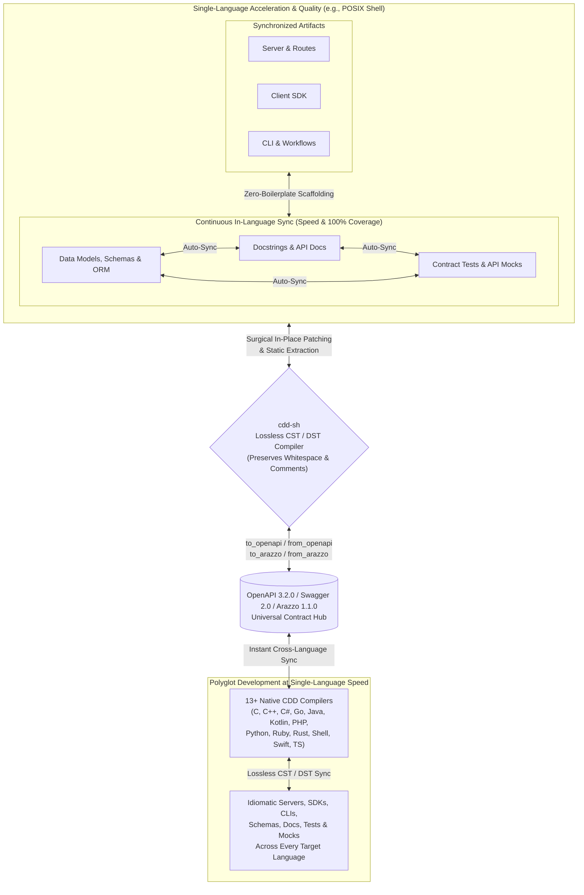

cdd-sh: POSIX Shell ⇄ OpenAPI
=============================

[](https://opensource.org/licenses/Apache-2.0)
[](https://offscale.io/wasm_web_demo)
[](https://github.com/SamuelMarks/cdd-sh/actions)
[](#)
[](#)

**cdd-sh** compiles **[OpenAPI](https://spec.openapis.org/oas/latest.html) / [Swagger](https://spec.openapis.org/oas/v2.0.html) / [Arazzo](https://spec.openapis.org/arazzo/latest.html)** to and from **POSIX Shell** (servers, client SDKs, CLIs, database schemas, tests, mocks, and docs), updating your existing code in-place without overwriting your edits.

**Compiler Driven Development (CDD)** is a software engineering methodology that uses a suite of standalone, lossless compilers to synchronize API specifications, server implementations, client SDKs, command-line tooling, workflow orchestrators, tests, and documentation.

Unlike traditional code generators that treat outputs as disposable or read-only, Compiler Driven Development provides a **complete, standalone compiler** (exposed as both a CLI and a programmatic SDK) written natively in each supported language. Where conventional compilers rely solely on an Abstract Syntax Tree (AST) that discards formatting and comments, CDD compilers operate on a **Concrete Syntax Tree (CST)** or **Decorated Syntax Tree (DST)**. This guarantees **lossless conversion**—preserving exact whitespace, indentation, inline comments, block comments, and docstrings—allowing true bidirectional synchronization between hand-edited `POSIX Shell` source code and [OpenAPI 3.2.0](https://spec.openapis.org/oas/v3.2.0.html), [Swagger 2.0](https://spec.openapis.org/oas/v2.0.html), and [Arazzo 1.1.0](https://spec.openapis.org/arazzo/v1.1.0.html) specifications.

---

## Why Compiler Driven Development?

By replacing one-way templates and manual boilerplate with lossless CST/DST compilers, Compiler Driven Development transforms the engineering lifecycle across four dimensions:

- **Development Speed**: Eliminate manual boilerplate across servers, client SDKs, CLIs, database models, workflow runners, and mock servers. Start from an [OpenAPI](https://spec.openapis.org/oas/latest.html) or [Arazzo](https://spec.openapis.org/arazzo/latest.html) specification to scaffold an entire installable project (complete with package manifests and CI workflows), or write code first in `POSIX Shell` and extract the specification automatically. When requirements change, update whichever representation is most convenient and synchronize the rest immediately.
- **Development Consistency**: Every data model, route handler, CLI flag, ORM entity, workflow step, and API contract is derived from and validated against the same semantic representation. Architectural drift between backend routes, frontend clients, and published specifications becomes structurally impossible.
- **Development Quality**: Keeping tests and documentation in lockstep with implementation code is automated rather than an afterthought. Because the compiler parses and emits docstrings, type signatures, API mocks, and contract test suites alongside your business logic, maintaining **100% documentation coverage and 100% test coverage** becomes a natural byproduct of compilation rather than a manual chore.
- **Polyglot Development**: Seamlessly bridge **13+ programming languages** (C, C++, C#, Go, Java, Kotlin, PHP, Python, Ruby, Rust, POSIX Shell, Swift, and TypeScript) to and from [OpenAPI](https://spec.openapis.org/oas/latest.html) and [Arazzo](https://spec.openapis.org/arazzo/latest.html) specifications. Any codebase in any supported language can be reverse-compiled into OpenAPI/Arazzo and immediately compiled forward into idiomatic, human-editable code across every other language in the suite. And being an open-source methodology—rather than a proprietary trade secret—new languages can be added by implementing new compilers that follow the CDD approach (see [cdd-spec-conformance](https://github.com/SamuelMarks/cdd-spec-conformance) for tooling to facilitate).

---

## The Standalone Compiler Architecture and Lossless Conversion

Traditional code generation tools rely on destructive templating: if you regenerate your project from an updated specification, your custom implementation logic, formatting, and comments are overwritten.

Each Compiler Driven Development toolchain is written natively in its target language, compiles both to native binaries and to **WebAssembly (WASM/WASI)**, and implements a full lexer, parser, semantic differ, and code emitter backed by Concrete Syntax Tree (CST) and Decorated Syntax Tree (DST) representations:

- **Beyond AST to CST/DST**: A standard Abstract Syntax Tree (AST) captures program semantics while stripping away "trivia" (whitespace, blank lines, and comments). By pairing structural AST semantics with a Concrete Syntax Tree (CST) or Decorated Syntax Tree (DST) that attaches trivia and structured documentation directly to syntax nodes, the compiler preserves 100% of your source formatting and comments.
- **Zero-Destruction Guarantee**: Every part of the generated codebase is designed to be edited by humans. You can open generated routing files, data models, database entities, workflow runners, tests, and CLI commands, format them to your preferences, add inline comments, and inject custom business logic.
- **When your specification changes**: The CDD compiler parses your existing source files into a CST/DST, computes a semantic diff against the updated [OpenAPI](https://spec.openapis.org/oas/latest.html) or [Arazzo](https://spec.openapis.org/arazzo/latest.html) specification, and surgically patches in new endpoints, workflows, parameters, or fields without disturbing your custom logic, comments, or whitespace.
- **When your codebase changes**: The compiler statically analyzes your updated source code, routes, workflows, tests, and docstrings—without unsafe dynamic code execution or reflection—to extract a 100% compliant, authoritative [OpenAPI](https://spec.openapis.org/oas/latest.html) or [Arazzo](https://spec.openapis.org/arazzo/latest.html) specification.

---

## The Bidirectional Synchronization Loop



The Compiler Driven Development lifecycle delivers compounding returns in both single-language and polyglot environments:
1. **Single-Language Speed**: Edit whichever artifact is most convenient—models/schemas, route handlers, docstrings, or tests—and let `cdd-sh` surgically synchronize the rest in-place without overwriting your custom logic, comments, or whitespace.
2. **Single-Language Quality**: Because schemas, documentation, contract tests, and mocks are continuously cross-compiled rather than manually maintained, **100% doc coverage and 100% test coverage** are enforced automatically on every sync.
3. **Polyglot Development at Single-Language Speed**: Extracting an authoritative [OpenAPI](https://spec.openapis.org/oas/latest.html) or [Arazzo](https://spec.openapis.org/arazzo/latest.html) contract from one language immediately drives lossless forward-compilation across all 13+ supported languages—making multi-language SDK, CLI, and service maintenance just as fast as working in a single codebase.

---

## Core Capabilities Shared Across All CDD Compilers

Every `cdd-*` repository in the suite implements the same foundational feature set:

- **Bidirectional OpenAPI 3.2.0 & Swagger 2.0 Compilation**:
  - `from_openapi`: Generate idiomatic `POSIX Shell` Client SDKs (`to_sdk`), Client CLIs (`to_sdk_cli`), and Server stubs/routers (`to_server`) from a single specification (`-i`) or a batch directory of specifications (`--input-dir`). Automatically upgrades legacy Swagger 2.0 and OpenAPI 3.0/3.1 specifications to OpenAPI 3.2.0.
  - `to_openapi`: Statically parse existing `POSIX Shell` source files or directories to extract a compliant OpenAPI 3.2.0 specification.
- **Bidirectional Arazzo 1.1.0 Workflow Orchestration**:
  - `from_arazzo`: Compile multi-step [Arazzo 1.1.0](https://spec.openapis.org/arazzo/v1.1.0.html) workflow specifications (including runtime expressions, step DAGs, criterion evaluations, and failure/success actions) into `POSIX Shell` SDK workflow orchestrators (`to_sdk`), CLI workflow runners (`to_sdk_cli`), and Server/E2E workflow test suites (`to_server`).
  - `to_arazzo`: Reverse-parse `POSIX Shell` workflow orchestrators, CLI scripts, or E2E test suites back into an authoritative Arazzo 1.1.0 document.
- **In-Place Codebase Synchronization (`sync`)**:
  - Synchronize data models, ORM schemas, route handlers, docstrings, contract tests, mocks, and specifications in-place using lossless CST/DST patching.
- **Documentation Code-Snippet Generation (`to_docs_json`)**:
  - Emit a structured JSON documentation payload containing idiomatic `POSIX Shell` request/workflow code snippets for every operation in an OpenAPI specification (with `--no-imports` and `--no-wrapping` options for embedding in documentation portals).
- **Composable Contract Tests, Mocks, CI, and Package Scaffolding**:
  - By default, `from_openapi` and `from_arazzo` scaffold complete, installable `POSIX Shell` packages and `.github/workflows/ci.yml` pipelines (configurable via `--no-installable-package` and `--no-github-actions`), and generate contract test suites and API mocks/fakes via `--tests`.
- **Model Context Protocol (`mcp`) & JSON-RPC (`serve_json_rpc`)**:
  - Run `cdd-sh mcp` to expose the compiler over stdio as an [MCP](https://modelcontextprotocol.io/) server for AI assistants and IDEs, or pass `--mcp` during generation to emit MCP tool/resource adapters directly inside generated SDKs and servers.
  - Run `cdd-sh serve_json_rpc` to expose the compiler's full API over JSON-RPC 2.0 (`--port`, `--listen`).
- **Native CLI, Programmatic SDK, and WebAssembly (WASM/WASI)**:
  - Use `cdd-sh` from the command line, import its programmatic SDK directly into `POSIX Shell` applications, or run it in the browser and WASI runtimes via its WebAssembly build (see [WASM.md](WASM.md)).

---

## The Global Polyglot Ecosystem

Every supported language operates on the same core Compiler Driven Development principles and is powered by a dedicated, native compiler tailored to that language's syntax tree, idioms, and package manager.

All implementations expose a standardized command-line interface (`cdd-sh <subcommand>`) and programmatic SDK.

| Repository | Language | Targets (`to_sdk`; `to_sdk_cli`; `to_server`) | Special Features Beyond Common Subset | Standards | CI Status |
|---|---|---|---|---|---|
| [`cdd-c`](https://github.com/SamuelMarks/cdd-c) | C (C89) | Client; Client CLI; Server | 42-Language FFI Generator (`bind`); GNU-to-C89 AST Lowering; Safe CRT & Memory Security Auditor; `c-orm` Migrations | [Arazzo 1.1.0](https://spec.openapis.org/arazzo/v1.1.0.html); [Swagger 2.0](https://spec.openapis.org/oas/v2.0.html); [OpenAPI 3.2.0](https://spec.openapis.org/oas/v3.2.0.html); [MCP](https://modelcontextprotocol.io/) | [](https://github.com/SamuelMarks/cdd-c/actions/workflows/ci.yml) |
| [`cdd-cpp`](https://github.com/SamuelMarks/cdd-cpp) | C++ | Client; Client CLI; Server | [Google Discovery](https://developers.google.com/discovery) (`from_google_discovery`); PostgreSQL `libpq` ORM & Faker Support | [Google Discovery](https://developers.google.com/discovery); [Arazzo 1.1.0](https://spec.openapis.org/arazzo/v1.1.0.html); [Swagger 2.0](https://spec.openapis.org/oas/v2.0.html); [OpenAPI 3.2.0](https://spec.openapis.org/oas/v3.2.0.html); [MCP](https://modelcontextprotocol.io/) | [](https://github.com/SamuelMarks/cdd-cpp/actions/workflows/ci.yml) |
| [`cdd-csharp`](https://github.com/SamuelMarks/cdd-csharp) | C# | Client; Client CLI; Server | CLR & Roslyn CST/DST Trivia-Preserving Sync; Entity Framework & Minimal API Targets | [Arazzo 1.1.0](https://spec.openapis.org/arazzo/v1.1.0.html); [Swagger 2.0](https://spec.openapis.org/oas/v2.0.html); [OpenAPI 3.2.0](https://spec.openapis.org/oas/v3.2.0.html); [MCP](https://modelcontextprotocol.io/) | [](https://github.com/SamuelMarks/cdd-csharp/actions/workflows/ci.yml) |
| [`cdd-go`](https://github.com/SamuelMarks/cdd-go) | Go | Client; Client CLI; Server | Go `dst`/`ast` Surgical Patching; Multi-Source Truth Sync (`code` ⇄ `openapi`) | [Arazzo 1.1.0](https://spec.openapis.org/arazzo/v1.1.0.html); [Swagger 2.0](https://spec.openapis.org/oas/v2.0.html); [OpenAPI 3.2.0](https://spec.openapis.org/oas/v3.2.0.html); [MCP](https://modelcontextprotocol.io/) | [](https://github.com/SamuelMarks/cdd-go/actions/workflows/ci.yml) |
| [`cdd-java`](https://github.com/SamuelMarks/cdd-java) | Java | Client; Client CLI; Server | JavaParser CST Lexical Preservation; WASI JSON-RPC Mode; In-Memory Compiler Pipeline | [Arazzo 1.1.0](https://spec.openapis.org/arazzo/v1.1.0.html); [Swagger 2.0](https://spec.openapis.org/oas/v2.0.html); [OpenAPI 3.2.0](https://spec.openapis.org/oas/v3.2.0.html); [MCP](https://modelcontextprotocol.io/) | [](https://github.com/SamuelMarks/cdd-java/actions/workflows/ci.yml) |
| [`cdd-kotlin`](https://github.com/offscale/cdd-kotlin) | Kotlin (Ktor Multiplatform) | Client; Client CLI; Server | Multiplatform Auto-Admin UI; Ephemeral & Seeded Mock Server Modes; Webhook Triggers | [Arazzo 1.1.0](https://spec.openapis.org/arazzo/v1.1.0.html); [Swagger 2.0](https://spec.openapis.org/oas/v2.0.html); [OpenAPI 3.2.0](https://spec.openapis.org/oas/v3.2.0.html); [MCP](https://modelcontextprotocol.io/) | [](https://github.com/offscale/cdd-kotlin/actions/workflows/ci.yml) |
| [`cdd-php`](https://github.com/SamuelMarks/cdd-php) | PHP | Client; Client CLI; Server | Multi-Tiered DAO (`StubDao` / `ConcreteDao`); Ephemeral & Faker-Seeded SQLite Server Modes | [Arazzo 1.1.0](https://spec.openapis.org/arazzo/v1.1.0.html); [Swagger 2.0](https://spec.openapis.org/oas/v2.0.html); [OpenAPI 3.2.0](https://spec.openapis.org/oas/v3.2.0.html); [MCP](https://modelcontextprotocol.io/) | [](https://github.com/SamuelMarks/cdd-php/actions/workflows/ci.yml) |
| [`cdd-python`](https://github.com/offscale/cdd-python) | Python | N/A (server building blocks) | CLI ⇄ SQLAlchemy ⇄ Pydantic ⇄ Docs ⇄ JSON Schema | N/A | [](https://github.com/offscale/cdd-python/actions) |
| [`cdd-python-all`](https://github.com/offscale/cdd-python-all) | Python | Client; Client CLI; Server | `LibCST` Lossless Sync; Multi-Truth Sync (`class`, `sqlalchemy`, `function`, `openapi`); FastAPI + SQLAlchemy | [Arazzo 1.1.0](https://spec.openapis.org/arazzo/v1.1.0.html); [Swagger 2.0](https://spec.openapis.org/oas/v2.0.html); [OpenAPI 3.2.0](https://spec.openapis.org/oas/v3.2.0.html); [MCP](https://modelcontextprotocol.io/) | [](https://github.com/offscale/cdd-python-all/actions/workflows/ci.yml) |
| [`cdd-ruby`](https://github.com/SamuelMarks/cdd-ruby) | Ruby | Client; Client CLI; Server | ActiveRecord Sync (`class`, `activerecord`, `function`); Ephemeral & Seeded Server Generation | [Arazzo 1.1.0](https://spec.openapis.org/arazzo/v1.1.0.html); [Swagger 2.0](https://spec.openapis.org/oas/v2.0.html); [OpenAPI 3.2.0](https://spec.openapis.org/oas/v3.2.0.html); [MCP](https://modelcontextprotocol.io/) | [](https://github.com/SamuelMarks/cdd-ruby/actions/workflows/ci.yml) |
| [`cdd-rust`](https://github.com/SamuelMarks/cdd-rust) | Rust | Client; Client CLI; Server | Actix-Web, Axum & Reqwest Targets; Diesel Schema Sync; Standalone `schema-gen`, `scaffold` & `test-gen` | [Arazzo 1.1.0](https://spec.openapis.org/arazzo/v1.1.0.html); [Swagger 2.0](https://spec.openapis.org/oas/v2.0.html); [OpenAPI 3.2.0](https://spec.openapis.org/oas/v3.2.0.html); [MCP](https://modelcontextprotocol.io/) | [](https://github.com/SamuelMarks/cdd-rust/actions/workflows/ci.yml) |
| [`cdd-sh`](https://github.com/SamuelMarks/cdd-sh) | Shell (`/bin/sh`) | Client; Client CLI; Server | Zero-Dependency Embedded `sh`/`jq`/`awk` Cross-Platform Binary; Direct AST `parse` & `emit` Subcommands | [Arazzo 1.1.0](https://spec.openapis.org/arazzo/v1.1.0.html); [Swagger 2.0](https://spec.openapis.org/oas/v2.0.html); [OpenAPI 3.2.0](https://spec.openapis.org/oas/v3.2.0.html); [MCP](https://modelcontextprotocol.io/) | [](https://github.com/SamuelMarks/cdd-sh/actions/workflows/ci.yml) |
| [`cdd-swift`](https://github.com/SamuelMarks/cdd-swift) | Swift | Client; Client CLI; Server | `SwiftSyntax` Lossless Merging (`merge_swift`); Vapor + Fluent ORM Scaffolding; `sync_arazzo` | [Arazzo 1.1.0](https://spec.openapis.org/arazzo/v1.1.0.html); [Swagger 2.0](https://spec.openapis.org/oas/v2.0.html); [OpenAPI 3.2.0](https://spec.openapis.org/oas/v3.2.0.html); [MCP](https://modelcontextprotocol.io/) | [](https://github.com/SamuelMarks/cdd-swift/actions/workflows/ci.yml) |
| [`cdd-ts`](https://github.com/offscale/cdd-ts) | TypeScript | Client; Client CLI; Server | Auto-Admin UI; Angular, React, Vue, Vanilla; Fetch, Axios, Node; Express, Bun, Deno; TypeORM Sync | [Arazzo 1.1.0](https://spec.openapis.org/arazzo/v1.1.0.html); [Swagger 2.0](https://spec.openapis.org/oas/v2.0.html); [OpenAPI 3.2.0](https://spec.openapis.org/oas/v3.2.0.html); [MCP](https://modelcontextprotocol.io/) | [](https://github.com/offscale/cdd-ts/actions/workflows/ci.yml) |

---

## Programmatic SDK & CLI Quickstart

Every `cdd-*` toolchain can be invoked either as a standalone CLI binary or imported as a native `POSIX Shell` library.

### Minimal CLI Usage

```sh
# Print help and version
cdd-sh --help
cdd-sh --version

# Generate a POSIX Shell Client SDK, Client CLI, or Server from an OpenAPI spec
cdd-sh from_openapi to_sdk -i spec.json -o ./sdk --tests
cdd-sh from_openapi to_sdk_cli -i spec.json -o ./cli --tests
cdd-sh from_openapi to_server -i spec.json -o ./server --tests

# Extract an OpenAPI 3.2.0 spec from existing POSIX Shell source code
cdd-sh to_openapi -i ./src -o openapi.json

# Generate and extract Arazzo 1.1.0 multi-step workflows
cdd-sh from_arazzo to_sdk -i workflow.arazzo.json -o ./workflows --tests
cdd-sh from_arazzo to_sdk_cli -i workflow.arazzo.json -o ./workflow-cli --tests
cdd-sh from_arazzo to_server -i workflow.arazzo.json -o ./workflow-server --tests
cdd-sh to_arazzo -i ./workflows -o extracted.arazzo.json

# Synchronize codebase models, routes, tests, docs, and OpenAPI in-place
cdd-sh sync -i ./src -o openapi.json

# Generate documentation-ready POSIX Shell code snippets JSON for an OpenAPI spec
cdd-sh to_docs_json --no-imports --no-wrapping -i spec.json -o docs.json

# Run as a Model Context Protocol (MCP) server over stdio or JSON-RPC 2.0 server
cdd-sh mcp
cdd-sh serve_json_rpc --port 8080 --listen 127.0.0.1
```

### Programmatic SDK Example

```sh
#!/bin/sh
set -eu

# 1. Initialize the cdd-sh environment and source modular compiler libraries
. ./lib/env.sh
. "${LIBSCRIPT_ROOT_DIR}/src/openapi/parse.sh"
. "${LIBSCRIPT_ROOT_DIR}/src/openapi/emit.sh"
. "${LIBSCRIPT_ROOT_DIR}/src/routes/emit.sh"
. "${LIBSCRIPT_ROOT_DIR}/src/routes/parse.sh"
. "${LIBSCRIPT_ROOT_DIR}/src/classes/emit.sh"
. "${LIBSCRIPT_ROOT_DIR}/src/sdk/emit.sh"
. "${LIBSCRIPT_ROOT_DIR}/src/arazzo/parse.sh"
. "${LIBSCRIPT_ROOT_DIR}/src/workflows/emit.sh"

export CDD_AST_PATH="./ast.json"

# 2. Parse an OpenAPI 3.2.0 (or Swagger 2.0) spec into the unified AST
handle_parse_openapi "tests/test.json"

# 3. Emit POSIX Shell Client SDK artifacts (routes, schema validators, MCP SDK)
mkdir -p ./out/src
handle_emit_routes "./out/src/routes.sh"
handle_emit_classes "./out/src/classes.sh"
handle_emit_sdk "./out/src/sdk.sh"

# 4. Parse modified POSIX Shell routes back into the AST and emit OpenAPI 3.2.0
handle_parse_routes "./out/src/routes.sh"
handle_emit_openapi "./out/openapi.json"

# 5. Parse an Arazzo 1.1.0 workflow specification and emit workflow orchestrators
handle_parse_arazzo "tests/test_arazzo.json"
handle_emit_workflows "./out/src/workflows.sh"
```

### Installation & Development

All `cdd-*` repositories support both native language build tools and a standardized cross-platform `Makefile` / `make.bat` interface (`deps`, `build`, `test`):

```sh
make deps
make build
make test
# or on Windows:
.\make.bat deps
.\make.bat build
.\make.bat test
```

```sh
# Run the POSIX Shell CLI directly or build the self-contained Go/WASM runner
sh ./cdd.sh --help
go build -o bin/cdd-sh-runner main.go

# Build the WASI / WebAssembly binary (wasm_build/cdd-sh.wasm)
GOOS=wasip1 GOARCH=wasm go build -o wasm_build/cdd-sh.wasm main.go

# Run Go unit tests (with 100% statement coverage) and POSIX Shell integration suites
go test -v -coverprofile=coverage.out ./...
sh ./test.sh

# Format and lint POSIX Shell and Go sources
shfmt -w -s -ln bash cdd.sh src/ lib/ tests/
shellcheck cdd.sh src/**/*.sh lib/**/*.sh tests/*.sh
go vet ./...
```

> **Further Documentation**:
> - [**ARCHITECTURE.md**](ARCHITECTURE.md) — Compiler pipeline (Lexer → CST/DST/AST → Semantic Diff → Emitter).
> - [**COMPLIANCE.md**](COMPLIANCE.md) — Swagger 2.0, OpenAPI 3.2.0, Arazzo 1.1.0, and MCP support matrices.
> - [**USAGE.md**](USAGE.md) — Detailed CLI, SDK, ORM, and roundtrip usage guide.
> - [**DEVELOPING.md**](DEVELOPING.md) — Local development, linting, testing, and coverage guide.
> - [**WASM.md**](WASM.md) — WebAssembly / WASI build and browser/Node.js execution instructions.
> - [**PUBLISH.md**](PUBLISH.md) — Package publishing and release workflow.

---

## Universal CLI Toolchain

Once you learn the Compiler Driven Development CLI in one language, you can use the exact same commands, flags, and environment variables across the entire polyglot stack.

### Common Arguments & Environment Variables

| Flag | Short | Environment Variable | Description |
|---|---|---|---|
| `--help` | `-h` | — | Print help information for the CLI or subcommand. |
| `--version` | `-v` / `-V` | — | Print version information. |
| `--input <path>` | `-i` / `-f` | `CDD_INPUT` | Path or URL to the input OpenAPI/Arazzo spec or source file/directory. |
| `--input-dir <dir>` | `-d` | `CDD_INPUT_DIR` | Directory containing multiple OpenAPI/Arazzo specifications for batch generation. |
| `--output <path>` | `-o` | `CDD_OUTPUT` | Destination file or directory path for generated code or extracted specifications. |
| `--tests` | `-t` | `CDD_TESTS` | Generate composable contract/integration tests and API mocks alongside code. |
| `--mcp` | `-m` | `CDD_MCP` | Generate Model Context Protocol (MCP) server and client adapters. |
| `--no-github-actions` | — | `CDD_NO_GITHUB_ACTIONS` | Do not generate `.github/workflows/ci.yml` scaffolding in target output. |
| `--no-installable-package` | — | `CDD_NO_INSTALLABLE_PACKAGE` | Do not generate package manifest/build files in target output. |
| `--no-imports` | — | `CDD_NO_IMPORTS` | (`to_docs_json`) Omit import/include statements from generated documentation snippets. |
| `--no-wrapping` | — | `CDD_NO_WRAPPING` | (`to_docs_json`) Omit boilerplate wrapper functions/classes from documentation snippets. |
| `--port <port>` | `-p` | `CDD_PORT` | (`serve_json_rpc`) TCP port to listen on (default: `8080`). |
| `--listen <addr>` | `-l` | `CDD_LISTEN` | (`serve_json_rpc`) Host/IP address to bind to (default: `127.0.0.1`). |
| `--truth <source>` | `-t` | `CDD_TRUTH` | (`sync`) Designate the single source of truth when synchronizing. |

### Core Subcommands

- **`from_openapi [to_sdk | to_sdk_cli | to_server]`**: Compile an OpenAPI 3.2.0 or Swagger 2.0 specification into an idiomatic `POSIX Shell` Client SDK, Client CLI, or HTTP Server (patching existing files losslessly if the target directory already exists).
- **`to_openapi`**: Statically parse `POSIX Shell` models, routes, client calls, and docstrings into an authoritative OpenAPI 3.2.0 specification.
- **`from_arazzo [to_sdk | to_sdk_cli | to_server]`**: Compile an Arazzo 1.1.0 workflow specification into `POSIX Shell` workflow orchestrators, CLI workflow runners, or server/E2E workflow test suites.
- **`to_arazzo`**: Statically parse `POSIX Shell` workflow code, CLI scripts, or E2E tests into an Arazzo 1.1.0 specification.
- **`sync`**: Bidirectionally synchronize `POSIX Shell` source files (models, ORM entities, routes, functions, tests, and docstrings) with OpenAPI/Arazzo specifications in-place.
- **`to_docs_json`**: Generate documentation-optimized JSON containing `POSIX Shell` code snippets for each operation in an OpenAPI specification.
- **`serve_json_rpc`**: Expose the `cdd-sh` compiler over a JSON-RPC 2.0 server for IDE integrations and external tooling.
- **`mcp`**: Run the `cdd-sh` compiler as a Model Context Protocol (MCP) server over standard I/O (`stdio`).

### Verbatim CLI Help Output

#### `cdd-sh --help`

```text
cdd-sh CLI
Usage:
  cdd-sh [subcommand] [options]

Subcommands:
  from_openapi    Generate code from an OpenAPI specification.
  to_openapi      Generate an OpenAPI specification from source code.
  from_arazzo     Generate workflow SDK, CLI, or Server from an Arazzo 1.1.0 specification.
  to_arazzo       Generate an Arazzo 1.1.0 specification from source code or tests.
  sync            Synchronize source code, tests, docs, and specifications in-place.
  to_docs_json    Generate JSON documentation with code snippets for an OpenAPI/Arazzo specification.
  serve_json_rpc  Expose CLI interface as a JSON-RPC server.
  mcp             Run as an MCP server over stdio.
  parse           Parse a source file or specification into the unified AST (ast.json).
  emit            Emit a target source file or specification from the unified AST (ast.json).

Options:
  --help, -h      Show this help message
  --version, -v   Show version information

Examples:
  cdd-sh to_openapi -i <code_file_or_dir> -o <spec.json>
  cdd-sh to_arazzo -i <code_file_or_dir> -o <arazzo.json>
  cdd-sh sync [--truth <source>] -i <code_file_or_dir> -o <target_dir>
  cdd-sh serve_json_rpc [-p|--port <port>] [-l|--listen <ip>]
  cdd-sh to_docs_json [--no-imports] [--no-wrapping] -i <spec.json> -o <docs.json>
  cdd-sh from_openapi [subcmd] -i <spec.json> -o <target_dir> [--no-github-actions] [--no-installable-package] [--tests]
  cdd-sh from_arazzo [subcmd] -i <arazzo.json> -o <target_dir> [--no-github-actions] [--no-installable-package] [--tests]

Note: All options can be passed via environment variables (e.g., CDD_PORT=8082 cdd-sh serve_json_rpc)
```

#### `cdd-sh from_openapi --help`

```text
Usage:
  cdd-sh from_openapi [subcmd] [options]

Subcommands:
  to_sdk          Generate a client SDK.
  to_sdk_cli      Generate a client SDK and CLI.
  to_server       Generate server boilerplate, models, and routes.
  to_openapi      Extract OpenAPI spec from an existing codebase.
  to_docs_json    Extract documentation data structure.

Options:
  -i, --input <spec>             Path to the OpenAPI specification file.
  -d, --input-dir <dir>          Path to a directory containing OpenAPI specification files.
  -o, --output <target_dir>      Destination path for generation.
  --no-github-actions            Skip generating GitHub Actions CI workflow.
  --no-installable-package       Skip generating package definitions (e.g., package.json).
  --tests                        Generate unit tests alongside the code.
  --ephemeral                    (Server) Use ephemeral in-memory storage.
  --seed                         (Server) Seed the database on startup.
  --strict-validation            (Server) Enforce strict OpenAPI request validation.
  --enforce-auth                 (Server) Enforce authentication for all endpoints.
  --start-auth-server            (Server) Start an embedded authentication server.
  --help, -h                     Show this help message.
```

#### `cdd-sh from_openapi to_sdk --help`

```text
Usage:
  cdd-sh from_openapi to_sdk [options]

Description:
  Generate a POSIX Shell client SDK (src/routes.sh, src/classes.sh, src/sdk.sh) from an OpenAPI specification.

Options:
  -i, --input <spec>             Path to the OpenAPI specification file.
  -d, --input-dir <dir>          Path to a directory containing OpenAPI specification files.
  -o, --output <target_dir>      Destination path for generation.
  --no-github-actions            Skip generating GitHub Actions CI workflow.
  --no-installable-package       Skip generating package definitions.
  --tests                        Generate route unit tests and mocks alongside the SDK.
  --help, -h                     Show this help message.
```

#### `cdd-sh from_openapi to_sdk_cli --help`

```text
Usage:
  cdd-sh from_openapi to_sdk_cli [options]

Description:
  Generate a POSIX Shell CLI and MCP stdio client (bin/sdk-cli) from an OpenAPI specification.

Options:
  -i, --input <spec>             Path to the OpenAPI specification file.
  -d, --input-dir <dir>          Path to a directory containing OpenAPI specification files.
  -o, --output <target_dir>      Destination path for generation.
  --no-github-actions            Skip generating GitHub Actions CI workflow.
  --no-installable-package       Skip generating package definitions.
  --tests                        Generate CLI tests alongside the code.
  --help, -h                     Show this help message.
```

#### `cdd-sh from_openapi to_server --help`

```text
Usage:
  cdd-sh from_openapi to_server [options]

Description:
  Generate a POSIX Shell HTTP and MCP SSE server (src/server.sh, src/routes/router.sh, src/models/*.sh, src/mocks/*.sh) from an OpenAPI specification.

Options:
  -i, --input <spec>             Path to the OpenAPI specification file.
  -d, --input-dir <dir>          Path to a directory containing OpenAPI specification files.
  -o, --output <target_dir>      Destination path for generation.
  --no-github-actions            Skip generating GitHub Actions CI workflow.
  --no-installable-package       Skip generating package definitions.
  --tests                        Generate server integration tests.
  --ephemeral                    Use ephemeral in-memory/temp SQLite storage.
  --seed                         Seed the database with Faker data on startup.
  --strict-validation            Enforce strict OpenAPI request validation.
  --enforce-auth                 Enforce authentication for all endpoints.
  --start-auth-server            Start an embedded authentication server.
  --help, -h                     Show this help message.
```

#### `cdd-sh to_openapi --help`

```text
Usage:
  cdd-sh to_openapi [options]

Options:
  -i, --input <code_file_or_dir> Path to the source code directory or file to parse.
  -o, --output <spec.json>       Destination path for the generated OpenAPI spec.
  --help, -h                     Show this help message.
```

#### `cdd-sh from_arazzo --help`

```text
Usage:
  cdd-sh from_arazzo [subcmd] [options]

Subcommands:
  to_sdk          Generate a client workflow SDK (src/workflows.sh + linked routes/classes).
  to_sdk_cli      Generate a client workflow SDK and CLI runner (bin/sdk-cli).
  to_server       Generate server with stateful workflow mocks and E2E workflow tests.
  to_arazzo       Extract Arazzo 1.1.0 spec from an existing codebase.
  to_docs_json    Extract documentation data structure with workflow snippets.

Options:
  -i, --input <arazzo.json>      Path to the Arazzo 1.1.0 specification file.
  -d, --input-dir <dir>          Path to a directory containing Arazzo and OpenAPI specification files.
  -o, --output <target_dir>      Destination path for generation.
  --no-github-actions            Skip generating GitHub Actions CI workflow.
  --no-installable-package       Skip generating package definitions.
  --tests                        Generate E2E workflow tests alongside the code.
  --help, -h                     Show this help message.
```

#### `cdd-sh from_arazzo to_sdk --help`

```text
Usage:
  cdd-sh from_arazzo to_sdk [options]

Description:
  Generate a POSIX Shell workflow SDK (src/workflows.sh and linked OpenAPI routes/classes) from an Arazzo 1.1.0 specification.

Options:
  -i, --input <arazzo.json>      Path to the Arazzo 1.1.0 specification file.
  -d, --input-dir <dir>          Path to a directory containing Arazzo and OpenAPI specification files.
  -o, --output <target_dir>      Destination path for generation.
  --no-github-actions            Skip generating GitHub Actions CI workflow.
  --no-installable-package       Skip generating package definitions.
  --tests                        Generate E2E workflow tests alongside the SDK.
  --help, -h                     Show this help message.
```

#### `cdd-sh from_arazzo to_sdk_cli --help`

```text
Usage:
  cdd-sh from_arazzo to_sdk_cli [options]

Description:
  Generate a POSIX Shell workflow CLI runner and MCP workflow server (bin/sdk-cli) from an Arazzo 1.1.0 specification.

Options:
  -i, --input <arazzo.json>      Path to the Arazzo 1.1.0 specification file.
  -d, --input-dir <dir>          Path to a directory containing Arazzo and OpenAPI specification files.
  -o, --output <target_dir>      Destination path for generation.
  --no-github-actions            Skip generating GitHub Actions CI workflow.
  --no-installable-package       Skip generating package definitions.
  --tests                        Generate CLI workflow tests alongside the code.
  --help, -h                     Show this help message.
```

#### `cdd-sh from_arazzo to_server --help`

```text
Usage:
  cdd-sh from_arazzo to_server [options]

Description:
  Generate a POSIX Shell server with stateful Arazzo workflow mock endpoints (/_mock/workflows) and E2E workflow tests.

Options:
  -i, --input <arazzo.json>      Path to the Arazzo 1.1.0 specification file.
  -d, --input-dir <dir>          Path to a directory containing Arazzo and OpenAPI specification files.
  -o, --output <target_dir>      Destination path for generation.
  --no-github-actions            Skip generating GitHub Actions CI workflow.
  --no-installable-package       Skip generating package definitions.
  --tests                        Generate E2E workflow tests alongside the server.
  --help, -h                     Show this help message.
```

#### `cdd-sh to_arazzo --help`

```text
Usage:
  cdd-sh to_arazzo [options]

Options:
  -i, --input <code_file_or_dir> Path to the workflow script, CLI, server, or directory to parse.
  -o, --output <arazzo.json>     Destination path for the generated Arazzo 1.1.0 spec.
  --help, -h                     Show this help message.
```

#### `cdd-sh sync --help`

```text
Usage:
  cdd-sh sync [options]

Description:
  Synchronize POSIX Shell source artifacts, documentation, tests, mocks, and OpenAPI/Arazzo specifications from a designated source of truth.

Options:
  --truth <source>               Source of truth (server, routes, classes, workflows, cli, openapi, arazzo, docstrings, tests, mocks; default: server).
  -i, --input <file>             Path to the input source of truth file.
  -o, --output <target_dir>      Destination directory for synchronized artifacts.
  --help, -h                     Show this help message.
```

#### `cdd-sh to_docs_json --help`

```text
Usage:
  cdd-sh to_docs_json [options]

Options:
  -i, --input <spec.json>        Path to the OpenAPI or Arazzo specification file.
  -o, --output <docs.json>       Destination path for the documentation data.
  --no-imports                   Do not include import statements in generated snippets.
  --no-wrapping                  Do not wrap the output in a top-level documentation object.
  --help, -h                     Show this help message.
```

#### `cdd-sh serve_json_rpc --help`

```text
Usage:
  cdd-sh serve_json_rpc [options]

Options:
  -p, --port <port>              Port to listen on (default: 8082).
  -l, --listen <ip>              IP to listen on (default: 0.0.0.0).
  --help, -h                     Show this help message.
```

#### `cdd-sh mcp --help`

```text
Usage:
  cdd-sh mcp [options]

Description:
  Run the cdd-sh CLI as a Model Context Protocol (MCP) server over standard I/O.

Options:
  --help, -h                     Show this help message.
```

#### `cdd-sh parse --help`

```text
Usage:
  cdd-sh parse <type> <file>

Description:
  Parse a specification or POSIX Shell artifact into the unified AST (ast.json).

Types:
  openapi                        Parse an OpenAPI 3.x or Swagger 2.0 JSON specification.
  arazzo                         Parse an Arazzo 1.0.1 / 1.1.0 JSON specification.
  routes                         Parse a client routes script (routes.sh).
  classes                        Parse a schema data models script (classes.sh).
  workflows                      Parse an Arazzo workflow orchestrator script (workflows.sh).
  server                         Parse a generated HTTP/MCP server script (server.sh).
  cli                            Parse a generated SDK CLI script (bin/sdk-cli).
  functions                      Parse standalone utility functions (functions.sh).
  docstrings                     Parse Markdown API documentation (docs.md).
  tests                          Parse route unit test scripts (test_routes.sh).
  mocks                          Parse mock response JSON payloads (mocks.json).

Options:
  --help, -h                     Show this help message.
```

#### `cdd-sh emit --help`

```text
Usage:
  cdd-sh emit <type> <file>

Description:
  Emit a specification or POSIX Shell artifact from the unified AST (ast.json).

Types:
  openapi                        Emit an OpenAPI 3.2.0 (or Swagger 2.0 via CDD_EMIT_SWAGGER2=1) JSON specification.
  arazzo                         Emit an Arazzo 1.1.0 JSON specification.
  routes                         Emit a client HTTP routes script (routes.sh).
  classes                        Emit a schema data models & validation script (classes.sh).
  workflows                      Emit an Arazzo workflow orchestrator script (workflows.sh).
  sdk                            Emit an MCP & Auth client SDK script (sdk.sh).
  server                         Emit an HTTP & MCP SSE server entrypoint script (server.sh).
  cli                            Emit a client CLI & workflow runner script (bin/sdk-cli).
  functions                      Emit standalone utility functions (functions.sh).
  docstrings                     Emit Markdown API documentation (docs.md).
  docsjson                       Emit documentation code-snippet JSON (docs.json).
  tests                          Emit route contract test scripts (test_routes.sh).
  mocks                          Emit mock response JSON and curl override scripts (mocks.json, mocks.sh).

Options:
  --help, -h                     Show this help message.
```

---

## Special Features Beyond the Common Compiler Driven Development Subset

While all compilers in this suite implement the full shared baseline above, `cdd-sh` implements additional capabilities tailored to the `POSIX Shell` ecosystem:

### 1. Zero-Dependency Embedded `sh`/`jq`/`awk` Cross-Platform & WASI Binary (`main.go`)
- **In-Process Interpreter Pipeline**: `cdd-sh` can run directly under any POSIX-compliant `/bin/sh` (`dash`, `ash`, `bash`, `zsh`, `ksh`) or compile into a single, zero-dependency Go/WASI binary (`bin/cdd-sh-runner` and `wasm_build/cdd-sh.wasm`).
- **Embedded VFS & Built-in Utilities**: Using Go's `//go:embed cdd.sh src lib ROOT`, `mvdan.cc/sh/v3/interp`, `gojq` (`internal/gojqcli`), and `goawk` (`internal/goawkcli`), the compiled runner intercepts calls to `jq`, `awk`, `mkdir`, `rm`, `cp`, `mv`, `cat`, `chmod`, and `touch` in-process without spawning external OS child processes or requiring host UNIX toolchains (see [WASM.md](WASM.md) and [JQ_WASM.md](JQ_WASM.md)).

### 2. Direct Unified AST `parse` and `emit` Subcommands
- **Granular Pipeline Access**: In addition to high-level commands (`from_openapi`, `to_openapi`, `from_arazzo`, `to_arazzo`, `sync`), `cdd-sh` exposes low-level `cdd-sh parse <type> <file>` and `cdd-sh emit <type> <file>` commands operating on the unified JSON intermediate representation (`CDD_AST_PATH`, defaulting to `ast.json`).
- **11 Parse Targets & 13 Emit Targets**: Directly parse or emit `openapi`, `arazzo`, `routes`, `classes`, `workflows`, `sdk`, `server`, `cli`, `functions`, `docstrings`, `docsjson`, `tests`, and `mocks`.
- **Bidirectional Swagger 2.0 ⇄ OpenAPI 3.2.0 Translation**: Automatically upgrades Swagger 2.0 specs (`host`, `basePath`, `schemes`, `definitions`, `securityDefinitions`, `in: body` / `in: formData`) into OpenAPI 3.2.0 (`src/openapi/swagger2openapi.jq`), and down-converts OpenAPI 3.2.0 to Swagger 2.0 when emitting to `*swagger*.json` or when `CDD_EMIT_SWAGGER2=1` is set (`src/openapi/openapi2swagger.jq`).

### 3. Lossless Annotation-Guided AST Merging (`lib/_common/merge.awk`)
- **Surgical Block-Level Merging**: When regenerating existing POSIX Shell files (`routes.sh`, `classes.sh`, `sdk.sh`, `workflows.sh`, `server.sh`, `bin/sdk-cli`, `test_routes.sh`), `lib/_common/merge.awk` matches annotated AST blocks (`# @function`, `# @class`, `# @webhook`, `# @workflow`) and updates generated signatures in-place while preserving custom helper functions, comments, and user edits outside or alongside generated blocks.

### 4. Multi-Tiered POSIX Shell HTTP & MCP SSE Server (`to_server`)
- **Pure-Shell HTTP & SSE Server (`src/server.sh`)**: Serves REST endpoints and Model Context Protocol (MCP) Server-Sent Events (`/sse` and `POST /mcp/message`) over `socat` or `nc` (`netcat`), complete with an `--handler` worker mode for inetd/socket-activation and serverless testing.
- **Dual-Layer DAO Architecture (`src/mocks/dao_stub.sh` & `src/mocks/dao_concrete.sh`)**:
  - `ACTIVE_DAO=stub`: Returns deterministic mock JSON responses derived from OpenAPI examples and schemas.
  - `ACTIVE_DAO=concrete`: Executes real SQL queries (`SELECT`, `INSERT`, `DELETE`) against a relational SQLite database (`sqlite3 -json` via `DATABASE_URL`) with auto-generated `CREATE TABLE IF NOT EXISTS` DDL migrations.
- **Server Runtime Flags & Environment Variables**:
  - `--ephemeral` (`CDD_EPHEMERAL=1`): Provisions an isolated temporary SQLite database (`/tmp/ephemeral_db_$$.sqlite`) that is automatically removed on exit.
  - `--seed` (`CDD_SEED=1`): Generates and executes realistic SQL `INSERT` seed data on startup using a pure-AWK schema-driven Faker engine (`src/server/seeder/faker.awk`).
  - `--strict-validation` (`CDD_STRICT_VALIDATION=1`): Validates incoming HTTP request bodies against per-model schema scripts (`src/models/model_<Schema>.sh`), returning `422 Unprocessable Entity` on constraint violations.
  - `--enforce-auth` (`CDD_ENFORCE_AUTH=1`) & `--start-auth-server` (`CDD_START_AUTH_SERVER=1`): Enforces Bearer token / API key authentication on protected operations and optionally exposes an embedded OAuth2 mock token issuer (`POST /oauth/token`).
  - Automatic CORS preflight handling (`OPTIONS`), `405 Method Not Allowed` with `Allow` header generation, and `404 Not Found` JSON error envelopes.

### 5. Pure-Shell Arazzo 1.1.0 Workflow Engine & Heuristic Reverse Parser (`lib/arazzo_runtime.sh`)
- **Complete 17-Root Runtime Expression Evaluator**: Evaluates `$url`, `$method`, `$statusCode`, `$request.header.*`, `$request.query.*`, `$request.path.*`, `$request.body`, `$response.header.*`, `$response.body`, `$message.header.*`, `$message.payload`, `$inputs.*`, `$outputs.*`, `$steps.*`, `$workflows.*`, `$sourceDescriptions.*`, `$components.*`, `$self`, and embedded `{expression}` string templates.
- **Multi-Format Selector & Payload Replacement Engine**: Extracts step outputs (`Selector Object`) and mutates request payloads (`Payload Replacement Object`) using RFC 6901 JSON Pointer (`jsonpointer`), RFC 9535 JSONPath (`jsonpath`), and a pure-AWK XML XPath evaluator (`xpath`, requiring zero external `xmllint` binaries).
- **State-Machine Orchestration & Server Mock Endpoints**: Supports `Criterion Object` assertions (`simple`, `regex`, `jsonpath`, `xpath`), `onSuccess`/`onFailure` transitions (`goto` step/workflow, `retry` with `retryAfter` & `retryLimit`, `end`), topological `dependsOn` DAG execution, CLI runner subcommands (`bin/sdk-cli workflow list|run`), and server-side stateful mock endpoints (`GET /_mock/workflows` and `POST /_mock/workflows/{workflowId}`).
- **Heuristic Shell-to-Arazzo Extraction**: `cdd-sh to_arazzo` parses both annotated `workflows.sh` scripts and unannotated POSIX shell functions or integration test scripts (`test_*.sh`) that invoke SDK route functions into valid Arazzo 1.1.0 specifications.

### 6. Full JSON Schema Draft 2020-12 Validation in Pure Shell & JQ (`src/classes/emit.jq`)
- Generates `validate_<Schema>()` functions enforcing `required`, `type` (including union type arrays and `nullable`), `enum`, `format` (`email`, `uuid`, `uri`, `hostname`, `ipv4`, `ipv6`, `date`, `date-time`, `byte`), numeric bounds (`minimum`, `maximum`, `exclusiveMinimum`, `exclusiveMaximum`, `multipleOf`), string bounds (`minLength`, `maxLength`, `pattern`), array constraints (`minItems`, `maxItems`, `uniqueItems`, recursive `items` `$ref` validation), object constraints (`minProperties`, `maxProperties`, `additionalProperties`, `readOnly`, `writeOnly`), and polymorphic combinators (`oneOf`, `anyOf`, `allOf`, `not`, `discriminator`).

---

## The End of Specification Drift

With Compiler Driven Development, API specifications, source code, database schemas, documentation, and tests are no longer loosely coupled artifacts that drift apart over time. Because the compiler preserves every comment, docstring, and whitespace token via Concrete and Decorated Syntax Trees (CST/DST), your specifications and your implementations remain strict, lossless reflections of one another across all 13+ languages throughout the entire software lifecycle.

---

## License

Licensed under either of

- Apache License, Version 2.0 ([LICENSE-APACHE](LICENSE-APACHE) or <https://www.apache.org/licenses/Apache-2.0>)
- MIT license ([LICENSE-MIT](LICENSE-MIT) or <https://opensource.org/licenses/MIT>)

at your option.

### Contribution

Unless you explicitly state otherwise, any contribution intentionally submitted
for inclusion in the work by you, as defined in the Apache-2.0 license, shall be
dual licensed as above, without any additional terms or conditions.
